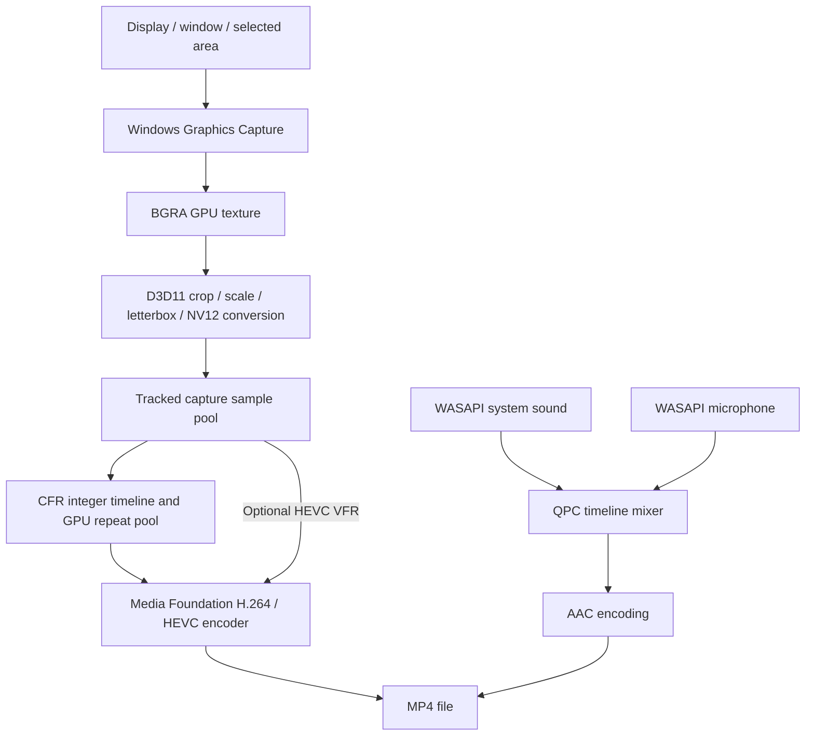
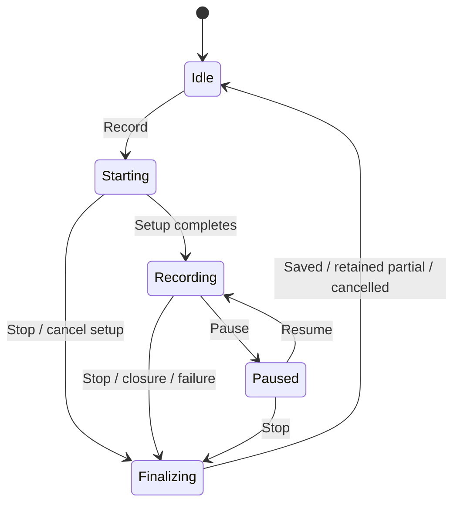

# Oculus — complete project guide and development status

**Snapshot:** 28 October 2026 · **Application version:** 0.1.0 · **License:** MIT

**Intended use:** personal use on the owner's Windows computer

**Basis:** current repository source, the development work recorded in this project, and retained local test results.

This is the detailed owner and developer handbook: what Oculus is, what it contains, how it works, what we have changed, what has actually been checked, and what remains. It records the current implementation rather than treating every old TODO description as current behavior.

Project documentation is maintained in three files: [README.md](README.md) for the quick start, this guide for the complete explanation, architecture, privacy, contribution instructions and change history, and [TODO.md](TODO.md) for the work checklist. `AGENTS.md` is separate repository configuration for coding tools.

The core recorder is implemented and has passed substantial local testing. The full backlog is unfinished. Some entries describe missing features; others describe code that exists but still needs hardware or interaction testing. Public-distribution work is deferred because you intend to use the application yourself. **You do not need a code-signing certificate for that use.**

## Contents

1. [Current status and what is left](#1-current-status-and-what-is-left)
2. [What the application is for](#2-what-the-application-is-for)
3. [What is available now](#3-what-is-available-now)
4. [How to use Oculus](#4-how-to-use-oculus)
5. [Settings and defaults](#5-settings-and-defaults)
6. [How the application works internally](#6-how-the-application-works-internally)
7. [What we have completed](#7-what-we-have-completed)
8. [The most recent recording-timing fix](#8-the-most-recent-recording-timing-fix)
9. [Validation results and their limits](#9-validation-results-and-their-limits)
10. [Remaining reliability work and acceptance checks](#10-remaining-reliability-work-and-acceptance-checks)
11. [Remaining feature and engineering backlog](#11-remaining-feature-and-engineering-backlog)
12. [Recommended order for personal use](#12-recommended-order-for-personal-use)
13. [Running, building, and testing the project](#13-running-building-and-testing-the-project)
14. [Files, privacy, and troubleshooting](#14-files-privacy-and-troubleshooting)
15. [Repository map and maintenance rules](#15-repository-map-and-maintenance-rules)
16. [Glossary and completion criteria](#16-glossary-and-completion-criteria)

## 1. Current status and what is left

### 1.1 Status at a glance

| Area | Current position |
| --- | --- |
| Basic recording | Display, window, and area recording are implemented |
| Video output | H.264 or HEVC MP4; constant frame rate by default |
| Recording safety | H.264 completed fragments survive the tested process-kill scenario; HEVC still needs normal finalization |
| Audio | System sound and microphone, endpoint selection, gains, live mute, one mixed AAC track |
| Screenshots | PNG capture, clipboard image/file data, area picker, floating feedback, optional sound |
| Saved files | Thumbnail/details card, Open, Show in folder, Copy file, Rename, and confirmed permanent Delete |
| Native desktop integration | Tray, configurable global shortcuts, single instance, compact record bar, optional launch at login |
| Diagnostics | Local rotating logs, panic backtraces, hardware/About information, copyable error details |
| Automated checks | Latest recorded run: 63 Rust tests passed, one interactive test ignored by the normal runner; 17 JavaScript tests passed |
| Media verification | Full verifier, repeated recordings, five-minute resource test, static-window test, and selected frame-rate/codec checks passed locally |
| Distribution artifacts | Release executable and NSIS installer build successfully |
| Overall scope | Working development application with remaining reliability validation and optional product work |

### 1.2 The next work that matters most to you

The most useful remaining work for personal use is:

1. **A one-hour recording soak:** inspect memory and handle trends, decode the whole file, and seek throughout it.
2. **A 15-minute physical audio/video synchronization test:** compare a visible and audible event near the beginning and end.
3. **Follow up on the intermittent overload:** it did not recur in the latest repeated/five-minute tests, but its original root cause remains unconfirmed.
4. **Finish area-selector acceptance testing:** keyboard confirmation/cancellation, moving/resizing, and any monitor/DPI layouts you actually use.
5. **Verify a real file drag into a local destination:** the native implementation exists; complete cross-application drop behavior is still pending.
6. **Test normal disruptions:** target minimization, sleep/resume, audio-device changes, and your actual output-drive behavior.
7. **Improve everyday usability:** a visible recording-area border, microphone meter, remembered sources/bar position, and recent recordings.

These are different kinds of work. Items 1–6 mostly validate or strengthen existing behavior. Item 7 adds features. Signing, package-manager listings, and public update infrastructure are unnecessary for your current personal-use scope.

### 1.3 How to read status labels

| Label | Meaning |
| --- | --- |
| Implemented and locally checked | Code exists and a relevant local check has run |
| Implemented; wider validation pending | Code exists, but additional hardware, OS, destination-app, or interaction checks remain |
| Partial | Some of a backlog entry is complete; the remaining part is named explicitly |
| Planned | The feature or engineering change is still missing |
| Deferred for personal use | Relevant mainly if distribution or sharing becomes a goal |
| Non-goal | Deliberately outside the current product scope |

No percentage-complete estimate is given. A small remaining checkbox can represent a difficult compatibility investigation, while a large feature can be optional for you.

## 2. What the application is for

Oculus is a local Windows screen recorder and screenshot tool. It is intended for tutorials, demonstrations, bug reports, software walkthroughs, and everyday captures.

Its main workflow is: select a source, choose audio, record, pause/resume if needed, stop, and use the saved file. Screenshots use the same source selection or an interactive area picker.

The application combines a small React interface with a Rust backend that uses native Windows capture, graphics, encoding, audio, clipboard, and Shell APIs. The backend owns the recording state. The interface displays that state and submits commands.


### 2.1 Product boundaries

| Included in the current product | Outside the current scope |
| --- | --- |
| Local display/window/area capture | Linux or macOS capture backends |
| MP4 recording and PNG screenshots | RTMP streaming |
| System/microphone audio | A full nonlinear video editor |
| Local files, clipboard, tray, and shortcuts | Mandatory accounts, cloud storage, or telemetry |
| Native Windows processing | Bundling FFmpeg or using Electron |

Webcam overlays, trimming, replay buffers, annotations, and optional sharing appear in the later-feature backlog. Their presence there does not mean they are already available or necessary before personal use.

### 2.2 Requirements

The application declares Windows 10 version 2004/build 19041 or later, or Windows 11, with WebView2 and a graphics driver/session that supports Windows Graphics Capture. Capture checks both the OS version and capture support and supplies contextual errors when unavailable.

The latest local checks used Windows build 26100 on a hybrid Intel UHD/NVIDIA RTX 3060 Laptop system. That establishes behavior on the tested machine, not complete support across all compatible Windows versions or GPUs. The presence of both adapters does not establish that cross-adapter capture performance has been characterized.

## 3. What is available now

### 3.1 Capture and encoding

| Capability | Current behavior | Qualification |
| --- | --- | --- |
| Screen capture | Select an individual display | Friendly hardware names and display thumbnails remain planned |
| Window capture | Select a native application window | Separate popup menus/tooltips may be omitted |
| Area capture | Pick a rectangle on a monitor | Selection across all monitors is implemented; mixed-DPI hardware validation remains |
| H.264 | Fragmented MP4 with CFR required | Best-tested crash-retaining path in this project |
| HEVC | Regular MP4, CFR by default, optional VFR | Requires successful finalization; hardware support varies |
| Frame rates | 24, 30, 48, 50, 60, 72, 120 fps | 144 fps and Match display remain planned |
| Output height | Original within encoder limits, or up to 720/1080/1440/2160 pixels tall | Preserves aspect ratio and does not upscale smaller sources |
| Quality | Low, Medium, High | The bitrate model still needs controlled size/quality comparisons |
| Custom bitrate | Optional whole-number 2–150 Mbps value | Actual encoder behavior still depends on the selected mode/vendor |
| Rate control | Encoder default, CBR, peak-constrained VBR | Explicit unsupported settings fail with guidance to use the default |
| Keyframes | Requests approximately a two-second GOP | Unsupported controls retain vendor defaults and are logged |
| Cursor | Capture-cursor option | Cursor highlighting, click ripples, and size boosts are missing |

Video encoding uses the chosen source's live content. Freezing the desktop during area selection is a selection aid; recording begins from the live source after confirmation.

### 3.2 Audio

| Capability | Current behavior | Remaining limitation |
| --- | --- | --- |
| System audio | Captures the selected Windows playback endpoint through WASAPI loopback | This is endpoint-wide audio, not per-application audio |
| Microphone | Captures the selected input endpoint | No level meter or noise processing yet |
| Device selection | Specific device or Default | Physical unplug/Bluetooth scenarios need additional testing |
| Default changes | Follows the relevant Windows default endpoint and retries reopening | Tested notification logic is not a substitute for all hardware switch tests |
| Gains | Approximately −∞ to +6 dB with a 0 dB detent and double-click reset | Configure gains before recording; live mute is a separate control |
| Live mute | Independent system/mic mute in the record bar | Capture remains active until Stop; mute silences saved audio |
| Output | One mixed stereo AAC stream, 48 kHz, configured for 192 kbps | Separate system/mic tracks are missing |
| Mixing | Places packets on a common timeline, fills silence, drops excessive overlap | Hard clipping remains; limiter and gradual drift resampling are planned |

Recording one application window does not automatically isolate that application's sound. Other sound on the selected playback endpoint can be included.

### 3.3 Screenshots and files

PNG screenshots can capture the selected display/window/area. Area screenshots save the frozen pixels shown in the picker. The clipboard option supplies both image data and a file-drop reference. Copy file replaces clipboard contents with the file representation rather than preserving an old image.

A successful screenshot displays a floating preview for approximately five seconds, including when the main panel is closed. Optional shutter sound starts disabled. Preview/card dragging uses the native Shell; complete destination-app drop validation remains pending.

Saved-file actions include Open, Show in folder, Copy file, Rename, and Delete. Rename preserves the extension and refuses overwrite. Delete is permanent after confirmation; there is no Recycle Bin or undo implementation. Missing thumbnails leave file actions usable with a fallback icon.

The card describes the latest remembered output. Expand **Recent recordings** in the panel
for the last ten completed or retained partial recordings, newest first, with thumbnails and
the same file actions. Rust owns this bounded list, so hiding to the tray and recreating the
panel preserves it. Rename and delete update the list and latest-save card together.
Screenshots do not evict recordings. The list clears on app exit; persistence across restarts
remains future work. File actions still require membership in the current output folder.

Local validation on 2026-10-28: four history regression tests cover bounds/order, partial files,
authorization, duplicate paths, and rename/delete propagation. The suite passed 67 Rust tests
(one existing Explorer test ignored) and 17 JavaScript tests. Formatting, Clippy, frontend and
debug desktop builds passed. Three short desktop recordings with system audio decoded fully;
pause/resume, newest-first display, thumbnails, expanded scrolling and tray recreation were
checked locally. These checks do not replace the longer hardware acceptance tests below.

## 4. How to use Oculus

### 4.1 Start and choose a source

Run `src-tauri/target/release/oculus.exe` from the repository after a release build. The current installer is under `src-tauri/target/release/bundle/nsis/`. WebView2 is still required even when running the executable directly.

The Screen tab shows individual displays. The Window tab lists capturable windows and supports basic title/process-name substring search. Minimized windows appear disabled with a restore hint. The Area tab opens the selector and also provides an immediate area-recording flow.

When no source has been explicitly selected, the primary display is the fallback. Source changes require stopping the current recording. Source identity is revalidated at start; a stale native handle is not accepted as sufficient identity.

### 4.2 Record, pause, and stop

1. Choose a display, window, or area.
2. Set system sound and microphone as required. The factory microphone default is off.
3. Check the save folder and recording settings.
4. Press Record or the configured global shortcut.
5. The interface enters Starting while devices/encoder initialize, then shows the compact record bar.
6. Pause removes that time from the saved timeline. Resume continues the same recording.
7. Live mute affects the chosen audio source without pausing video.
8. Press Stop and allow Saving/finalization to finish.
9. Use the saved-output card, or open the output folder.

Stop during Starting cancels setup. Starting a second recording while one is active is rejected. The timer freezes during pause and finalization. Closing the main panel sends the application to the tray; use explicit Quit to exit.

H.264 with CFR is the current default. HEVC's remaining crash vulnerability matters even for personal recordings, so important HEVC recordings need a normal Stop/finalization path.

### 4.3 Select an area

| Input | Behavior implemented in the native picker |
| --- | --- |
| Drag | Draw a rectangle |
| Click a highlighted window | Select its window rectangle |
| Drag inside an existing selection | Move it |
| Drag an edge/corner handle | Resize it |
| Enter | Confirm the selection |
| Escape or right-click | Cancel the selection across its monitor workers |
| Arrow keys | Move by one physical pixel |
| Shift + arrow | Move by ten pixels |
| Alt + arrow | Resize the right/bottom edges |
| Space | Toggle move mode |
| Hold Shift while drawing | Draw a square |

Labels are measured and clamped to the display, with DPI-scaled text and crosshair guides. Keyboard geometry is unit-tested; full physical keyboard/focus acceptance testing remains open.

Screenshot crops preserve physical pixel coordinates, including odd dimensions. Encoded NV12 video needs even dimensions, so a 641×479 input crop can produce 640×478 video. A monitor's position to the left/above the primary display also needs correct negative-coordinate handling; that hardware scenario remains to be exercised.

### 4.4 Default shortcuts and tray behavior

| Factory shortcut | Action |
| --- | --- |
| Ctrl+Shift+R | Start/stop recording |
| Ctrl+Shift+P | Pause/resume |
| Ctrl+Shift+S | Screenshot of the current source |
| Ctrl+Shift+A | Area screenshot |

Settings → Hotkeys accepts editable shortcut text, empty individual bindings, or disabling global hotkeys entirely. Optional bindings for microphone mute, immediate area recording, and recording the window under the cursor start unassigned. Shortcut press-to-capture controls are still planned.

Conflicts leave the previous configuration active. Tray/panel controls remain available when shortcuts are disabled. Record toggling has a 400 ms repeat guard.

The tray indicates recording in red, pause in amber, and startup/saving in grey; its tooltip includes state/time. Left-click opens the panel. Quit waits for active recording finalization. A second normal launch focuses the existing instance.

## 5. Settings and defaults

These are factory defaults from the Rust settings structure. Your saved preferences can differ.

| Setting | Factory value | Notes |
| --- | --- | --- |
| Codec | H.264 | Fragmented MP4 |
| Frame rate | 60 fps | Requires compatible capture/encoder performance |
| Constant frame rate | On | Enforced for H.264; optional for HEVC |
| Output height | Original within encoder limits | Height choices limit size without upscaling |
| Quality | Medium | Low/Medium/High presets |
| Custom bitrate | Automatic | Manual range: 2–150 Mbps |
| Rate control | Encoder default | CBR/VBR are optional |
| Capture cursor | On | Effects are not implemented |
| System sound | On | Default playback endpoint |
| Microphone | Off | Default input endpoint when enabled |
| System/mic gain | 1.0, displayed as 0 dB | Approximately 2.0 maximum gain |
| Copy screenshots | On | Image plus file-drop data |
| Screenshot sound | Off | Optional synthesized shutter |
| Launch at login | Off | Starts in the tray when enabled |
| Global hotkeys | On | Four factory bindings above |
| Output folder | Videos\Oculus when no folder is saved | Unavailable folders trigger a write-probed fallback and notice |
| Settings schema | Version 1 | Safe defaults populate missing legacy fields |

Settings writes are serialized, flushed to a same-directory temporary file, and atomically replaced. Corrupt files are backed up and reported. A newer unsupported schema cannot be overwritten through the settings command. Frontend writes are queued, and slider commits are debounced to avoid dozens of writes per second.

Launch-at-login uses the current user's Windows Run entry with a quoted executable path and `--tray`. Registry changes preserve the previous value for rollback if persistence fails. Actual login behavior and installer/move-path lifecycle still need testing.

## 6. How the application works internally

### 6.1 Main technologies

| Layer | Technology | Responsibility |
| --- | --- | --- |
| Interface | React 19, JavaScript/JSX, CSS | Source picker, settings, record bar, feedback, file actions |
| Desktop shell | Tauri 2 and WebView2 | Native window lifecycle, local IPC, tray, shortcuts, dialogs |
| Application backend | Rust 2021 | Recorder state, commands, settings, session lifetime, errors |
| Capture | Windows Graphics Capture | Frames as GPU textures |
| Image processing | D3D11 VideoProcessor | Crop, resize, letterbox, BGRA-to-NV12 conversion |
| Encoding/container | Windows Media Foundation | H.264/HEVC, AAC, MP4 writing/finalization |
| Audio capture | WASAPI | System loopback and microphone packets |
| Native selection | Win32, Direct2D, DirectWrite | Frozen selection windows, handles, labels, keyboard input |
| Files/clipboard | Windows Shell and clipboard APIs | Reveal, thumbnails, file copying, drag/drop |

FFmpeg is used by developer verification scripts only. It is not bundled or used as the normal recording engine.

### 6.2 Recording pipeline



A recording creates one protected D3D11 device. Capture, conversion, and encoding use compatible resources on that device. CFR repeats add GPU copies into their own bounded pool. The video path avoids CPU pixel readback; screenshots intentionally read pixels to the CPU for PNG encoding.

The capture pool and CFR repeat pool each begin with six samples and cap at twelve. Samples return only after Media Foundation's tracked-sample notification says the encoder has released them. Reusing a surface too early could corrupt a frame still being encoded.

CFR repeat-pool waiting is bounded at 250 ms, and catch-up is limited to two seconds of frames. The application reports failure and retains partial output instead of allocating an unlimited backlog.

### 6.3 State, UI, and worker ownership



The backend is authoritative. Every state snapshot has an increasing `seq`. The frontend subscribes before requesting initial state, then accepts only newer snapshots. This prevents late hydration or delayed events from restoring an old Recording state after the session has ended.

Encoder/device setup runs outside the recorder mutex. A generation check and completion barrier prevent a cancelled setup or stale callback from becoming the active session. Session-specific tickers also reject stale generations.

Important workers include the recording writer, WGC callback, system/mic capture threads, mixer, state ticker, native lifecycle handler, and per-monitor selection workers. Blocking file/graphics work is moved off the UI command thread. Native window/tray operations are dispatched to the appropriate UI thread.

Sending the panel to the tray destroys its WebView rather than keeping a hidden browser process tree. Rust state, shortcuts, and the tray continue. Reopening creates a new UI that hydrates from the current backend state.

Release builds use a fail-stop panic policy (`panic = "abort"`). A panic report/backtrace is written where possible, and the process terminates. Poisoned recording mutexes are not silently recovered into a potentially inconsistent live session. Recovery of already written output follows the container limitations described below.

### 6.4 Timing and audio placement

Video and audio use QPC timestamps in 100-nanosecond units. The first accepted video frame establishes the timeline origin. Pre-roll audio is discarded or trimmed. The clock retains all pause intervals so late packets are mapped through the correct pauses.

The mixer uses a 48 kHz stereo timeline and emits approximately 100 ms behind the clock to allow packet arrival jitter. Differences within roughly 20 ms are absorbed by normal appending. Larger gaps insert silence; excessive overlaps are dropped. These corrections can still warrant audible-quality investigation.

Stop freezes the clock immediately. Teardown then closes capture, stops/joins audio workers, drains accepted media, checks overload, completes the final video sample, pads any remaining audio endpoint gap, and attempts finalization.

### 6.5 Files, shutdown, and backpressure

The writer media queue holds at most 128 packets; audio input holds at most 64. Producers use nonblocking sends. A separate one-slot control channel carries Stop/end requests, so a full media queue cannot block the UI's Stop command.

The writer drains media while polling audio preflight notifications. Capture and the mixer
already run at this point, so waiting synchronously for a slow endpoint would fill the writer
queue even with a healthy encoder. Starting remains visible until all initial audio health
notifications arrive or their workers exit. Ending capture before that point reports a startup
failure instead of committing an already-ended session.

New output filenames are reserved atomically with collision suffixes. Failed startup cleans up its placeholder. Runtime recording failures retain partial output and report its location.

H.264 writes completed MP4 fragments during recording. HEVC uses the regular MP4 sink because the tested fragmented sink rejects its media type. Neither path guarantees data still buffered by the OS during power loss.

Quit waits for finalization without an application deadline. Windows session-ending and suspend handlers request finalization too. Actual OS shutdown limits and forced termination can still interrupt the process; those hardware lifecycle tests remain open.

### 6.6 Detailed architecture contracts

| Execution context | Ownership and responsibility |
| --- | --- |
| Tauri main thread | Native windows, tray changes, short IPC handlers and the Shell drag loop |
| Recording start worker | Source/output validation and session initialization outside the recorder mutex |
| WGC callback | Timestamp/cap input, acquire a capture sample, convert and enqueue without waiting on the writer |
| `oculus-writer` | Own Media Foundation, consume typed media messages, produce keep-alives/CFR repeats, drain and finalize |
| Up to two WASAPI workers | Capture the configured system/mic endpoints, report health and reopen on relevant device changes/errors |
| Mixer worker | Place packets on the clock timeline, mix and enqueue PCM16 |
| Recorder ticker | Publish stats/health/time and check free space once per second; retire when its generation becomes stale |
| Windows lifecycle thread | Coordinate suspend/logoff/shutdown finalization without blocking the Tauri UI thread |
| Per-monitor selection workers | Own native overlay windows/message loops; coordinate the first confirmation/cancellation and join before returning |
| Shell metadata/reveal workers | Enter an STA for native Shell work and release COM/PIDL resources within that apartment |

The shared D3D11 immediate context is multithread-protected. There is one graphics device per recording session, not a global device cache. Textures from another device must not be substituted into the capture/conversion/encode path. The converter explicitly uses full-range RGB BT.709 input and studio-range YCbCr BT.709 output. Output dimensions stay fixed; resized source content is fitted into that canvas.

Capture and keep-alive code serialize converter, pool and last-image bookkeeping through one mutex. Recorder state has a different mutex. Native tray setters are dispatched without synchronously waiting while holding the recorder lock, and tray updates reject stale snapshot sequences.

The `Mta<T>` wrapper in `src-tauri/src/util.rs` implements Send only for the specific MF samples, WinRT D3D devices, D3D11 textures and GPU/texture pairs used by the pipeline. It has no blanket Send/Sync implementation. Other interface-specific wrappers retain their documented threading contracts. Shell helpers enter an STA and release native resources before uninitializing COM.

The tracked NV12 allocator callback is rearmed for each checkout. Its free-list reference is weak so outstanding samples cannot keep the entire pool alive through a reference cycle. `WriteSample` returning is insufficient evidence that the GPU texture can be overwritten. Capture counts and drops an image when its pool is full; writer repeats use their separate bounded pool and bounded waiting policy. Queue peaks measure packet counts rather than bytes.

Saved-output metadata uses the same ordered snapshots as recorder state. File duration comes from the written video endpoint, and Shell thumbnail generation runs separately after saving. Rename uses a native move without replacement; the UI waits for backend state after mutations.

Screenshot feedback is a temporary, capture-excluded WebView with event-listen/unlisten permissions only. It subscribes before hydration. Generation counters prevent an older expiry timer from destroying a newer preview; native dragging holds expiry and restarts it afterward. The preview can exist while the main WebView is destroyed in the tray.

Area selection shares one device across its monitor workers. Geometry stays in monitor-relative physical pixels; only encoded output dimensions are even-aligned. All remaining workers close and join when the coordinator receives the first result. This prevents a cancelled or confirmed selection from leaving another monitor's picker running.

Hotkey registration/persistence is a transaction, while shortcut event dispatch reads the settings store without the registration mutex. This separation avoids deadlocking a worker against registration that needs the main thread. Launch-at-login changes also restore the prior registry value if persistence fails.

The main WebView cannot emit recorder events through the Tauri event plugin. It receives explicit event subscription/titlebar/folder-picker permissions, and custom Rust commands remain responsible for argument authorization. These constraints complement the production CSP; frontend code alone is not the file-access security boundary.

Release panic handling terminates rather than continuing an inconsistent session. Debug builds can unwind and poison a mutex; later `unwrap` access can panic again. Panic reporting does not promise successful finalization. Already completed H.264 fragments are the current recovery boundary.

## 7. What we have completed

The initial repository already contained the native capture/encode/audio pipeline and basic Tauri interface. This development effort has extended and hardened that baseline. The following records the resulting behavior, not a claim that every line was newly created during the latest session.

### 7.1 Recording and data safety

| Earlier issue | Change now implemented | Evidence/remaining qualification |
| --- | --- | --- |
| Same-second names could collide | Atomic filename reservation and suffix retries | Collision/concurrency tests and actual saves |
| H.264 hard termination left an unusable regular MP4 | Fragmented H.264 output | Completed fragments survived a debug hard exit and decoded |
| Runtime failure could discard useful output | Preserve partial recording and report it | Overload/failure verification |
| Quit could truncate recording | Wait for completion callback and show Saving | Delayed-finalization app test |
| Stop during startup could race setup | Starting state, cancellation, generations, commit barrier | Real-app cancellation and Rust tests |
| Setup held the recorder lock | Expensive initialization outside the mutex | Responsive Stop/state access during setup |
| Repeated Record shortcut toggled twice | 400 ms debounce | Boundary tests |
| Raw monitor/window handles could become stale | Monitor device identity and window process/executable/title checks | Identity/region-bound tests |
| Successful target closure looked like an error | Neutral save notice | Implemented state distinction |
| Unavailable output path blocked capture | Write-probed fallback and visible notice | Unit checks; live removable/network scenarios pending |
| Disk exhaustion could corrupt long output | Warn below 2 GiB; stop/finalize below 200 MiB | Guard implemented; live low-space behavior pending |
| Unbounded producer buffering | Fixed queue capacities and visible overload stop | Injected writer/mixer stall checks |

### 7.2 Audio and timing

Implemented default-device notifications, capture-error recovery/reopen attempts, per-source health, microphone privacy guidance, explicit device dropdowns, live mute, dB gain controls, and complete pause-history mapping.

The mixer now flushes its final short chunk, including disconnected-input paths. Finalization pads audio to the last video endpoint when necessary. The latest timing work freezes Stop and produces a complete CFR grid for H.264. Integer grid tests cover an hour's timestamp arithmetic without per-frame rounding accumulation.

Separate tracks, meters, limiting, microphone processing, and gradual resampling remain missing. The original intermittent overload has better instrumentation but no confirmed root-cause diagnosis.

### 7.3 Screenshots and saved-file operations

Implemented the shared output card, native Shell thumbnails, size/duration metadata, authorized saved-file commands, no-overwrite rename, confirmed permanent Delete, image/file clipboard formats, floating screenshot preview, optional sound, and native drag initiation.

File access resolves canonical paths within the current output folder. Open/Copy/Rename/Delete additionally require an output remembered by the recorder. Native Shell item APIs handle commas/Unicode without constructing an Explorer selection command string. Browser checks cover click versus drag threshold and keyboard activation; actual cross-app drop acceptance remains open.

### 7.4 Source selection, area controls, and interface

Implemented debounced focus refresh, immediate manual refresh, stale-response rejection, focused/visible polling, retained source lists on refresh failure, and minimized-window hints. The implementation uses polling; the event-hook approach described in older TODO wording is not the current mechanism.

The area picker now creates coordinated per-monitor native windows, supports adjustment before confirmation, crosshairs, snapping to window rectangles, keyboard geometry, measured/clamped labels, and DPI-scaled text. The first result or cancellation shuts down the other workers before returning.

Settings gained named sections, Back navigation, scrolling, keyboard-accessible controls, dB readouts, and focus restoration. Error banners are dismissible, selectable, bounded, scrollable, and copyable. High-contrast testing found overlapping settings controls; that defect was fixed and checked at a 320×420 viewport.

The compact timer interpolates between accepted snapshots and freezes when paused/saving. Tray state updates use a sequence guard. The saved-file card remains accessible beside errors.

### 7.5 Shortcuts, persistence, diagnostics, and tooling

Hotkey changes register additions before removing old bindings and persisting settings. Conflicts or disk errors roll back. Event dispatch reads settings without taking the registration transaction mutex, avoiding a main-thread registration deadlock. A real OS shortcut conflict was rejected while retaining the previous binding.

Settings now have schema version 1, safe legacy defaults, corruption backups, atomic replacement, and serialized frontend/backend updates. Launch-at-login has rollback support. Narrow `Mta<T>` Send implementations replaced the former blanket Send/Sync wrapper.

Local diagnostics include rotating logs, a panic report/backtrace, readable HRESULT context, GPU/driver/audio/capture information, encoder candidates, and the actual selected encoder. Codec-filtered lookup fixes a vendor-name ambiguity that could label HEVC as H.264.

Added the pinned Rust toolchain, formatting baseline, version synchronization/checking, changelog, contributor guide, bug-report template, privacy statement, Windows build workflow, security workflow, and Dependabot configuration. Workflow YAML parses locally; GitHub execution is still pending. Dependency audit history reported no vulnerabilities but did include informational upstream warnings outside the Windows target's dependency tree.

### 7.6 Change history

This is the project's consolidated change log. Detailed behavior and evidence appear in the surrounding chapters.

| Version/state | Changes |
| --- | --- |
| Unreleased — startup reliability | Drain media during audio preflight, reproduce delayed readiness in debug builds, verify the regression, and retain stress-run environment/storage evidence |
| Unreleased — recent recordings | Expandable last-ten recording list for the current app session, including partial outputs, thumbnails, file actions, and synchronized rename/delete |
| Unreleased — timing reliability | Constant frame grid for H.264, independently pooled GPU repeats, Stop-time clock freeze, aligned final frame/audio endpoint, encoder-write diagnostics and repeated/long resource checks |
| Unreleased — recording safety | Interrupted H.264 retention, coordinated exit/finalization, bounded buffers, device recovery and preserved partial output |
| Unreleased — files and screenshots | Saved-output cards/actions, screenshot preview, optional shutter sound, native file dragging and image/file clipboard formats |
| Unreleased — controls | Transactional configurable hotkeys, selected audio devices, live mute, dB gains, launch-at-login and copyable diagnostics |
| Unreleased — video/selection | Bitrate/rate-control/height settings, more frame rates, actual encoder identification, per-monitor picker overlays, snapping, resize and keyboard adjustment |
| Unreleased — interface/tooling | Accessible controls, settings sections/persistence, high-contrast/compact layout, contextual errors, Windows CI/security checks and synchronized version tooling |
| 0.1.0 | Initial development version; public-release validation remains incomplete |

When changing the application version, add its dated release notes here and keep the detailed status/evidence and TODO checklist current. Consolidating documentation does not itself change the application version.

## 8. The most recent recording-timing fix

### 8.1 What was found

An intermittent normal-recording overload prompted repeated short captures and a longer resource test. The new checks exposed a separate, reproducible timing problem: sparse-frame H.264 files could have video roughly 200–270 ms shorter than audio in short recordings.

Packet inspection showed loss at fragmented-video boundaries. Supplying accurate input sample durations alone did not correct the tested Windows fragmented sink. The problem was particularly relevant to static content, where capture delivers few new frames.

### 8.2 How it was addressed

H.264 now requires CFR. The encoder writer maps input images onto an integer frame grid, repeats images where necessary, and finishes the last frame at the frozen Stop endpoint. HEVC defaults to CFR and can retain VFR in its regular container path.

Repeats use their own tracked GPU surfaces, separately capped from capture. The final approach avoids retaining capture surfaces behind the encoder's buffering. It adds GPU copying/encoding work on static content while preserving the normal video path's lack of CPU image readback.

A 60 fps output can contain repeated images. CFR preserves the output timeline; it does not create extra motion detail when the source supplies fewer distinct images. Arrived capture frames and encoded output frames therefore have different meanings in diagnostics.

The frontend locks CFR on for H.264. Changing from HEVC VFR back to H.264 restores CFR. Backend sanitization also enforces this rule, including settings loaded from older files.

### 8.3 What remains unresolved

H.264 VFR should stay disabled until a muxing path preserves sparse timing across fragments and passes the same tests. HEVC crash recovery is a separate container problem. The intermittent original overload was not reproduced in the latest acceptance runs; the timing fix is not proof of its cause or permanent elimination.

New diagnostics record slow writes, maximum write durations, written/timeline endpoints, and the first queue rejection to support a future investigation.

## 9. Validation results and their limits

These are the latest retained results, not a new rerun performed solely to write this guide.

### 9.1 Checks recorded as passing

| Check | Result |
| --- | --- |
| Rust unit tests | 69 passed after the startup fix; one interactive Explorer test ignored by the regular runner |
| Interactive Explorer test | Previously run separately and passed |
| JavaScript tests | 17 passed |
| Rust formatting/Clippy | Formatting check and all-target Clippy with warnings denied passed |
| Frontend/debug/release | Builds passed |
| NSIS | Built successfully; current artifact is 1,858,599 bytes, approximately 1.77 MiB |
| Release executable | 5,772,800 bytes, approximately 5.51 MiB; opened successfully |
| Full media verifier | H.264/HEVC decode/seek, delayed audio preflight, pause/resume, Stop while paused, overload retention, hard exit, startup cancellation, delayed quit |
| Repeated recordings | Six eight-second wall-time clips with a three-second pause; all passed |
| Five-minute recording | CFR, audio endpoints, decode, seeking, and resource bounds passed |
| Static-window recording | One delivered WGC frame produced a valid 30-second CFR recording |
| Other rates/codecs | 72 fps, 120 fps/720p, and HEVC VFR files decoded |
| Native settings | H.264 CFR enforcement and codec switching checked; original settings restored |
| Clipboard | Screenshot image plus file-drop data; Copy file clears stale image data |
| Layout | High-contrast and compact-viewport checks; settings-overlap regression corrected |

### 9.2 Five-minute measurement

| Measurement | Recorded value |
| --- | --- |
| Wall recording interval | Approximately 300 seconds |
| Pause | Approximately five seconds |
| Video duration | 295.100 seconds |
| AAC duration | 295.104 seconds |
| Endpoint difference | Audio ends 4 ms after video |
| Video frames | 17,706, matching 60 fps |
| Resource samples | 61 |
| Warm-up-to-end mean private-memory growth | 6.89 MiB |
| Warm-up-to-end mean handle change | −8.33 handles |
| Private memory during measured period | Roughly 246–253 MiB |
| Rejected writer/audio packets | Zero |
| Maximum video sample-write time | 5,249 µs, about 5.25 ms |
| Maximum audio sample-write time | 264 µs |
| Writes exceeding 100 ms | Zero |
| CPU reported by debug driver | 20.3% of one CPU core, including setup |

Resource growth compares the first three samples after the 20-second warm-up with the last three samples. Fractional handle change is a difference between averages. The script's investigation thresholds are 64 MiB of private-memory growth or 16 added handles. Passing those bounds does not establish the absence of a small leak.

The measurement covers the headless recording process. It excludes a separate open UI's WebView processes, GPU memory accounting, and other applications. Older tray/UI memory baselines predate CFR and should be remeasured rather than compared directly with this recording-only number.

### 9.3 Sparse/static content and additional modes

| Case | Video | Audio endpoint difference | Result |
| --- | --- | --- | --- |
| Static browser window | 1,811 frames / 30.183333 s / 60 fps, with only one WGC frame delivered | About +3 ms | Full decode passed |
| 120 fps, 720p | 495 frames / 4.125 s | About +13.7 ms | Full decode passed |
| 72 fps | 224 frames / 3.111111 s | About +3.6 ms | Full decode passed |
| HEVC VFR with pause | 143 frames / 4.102933 s | About +14.4 ms | Full decode passed |

Earlier CBR 24 fps/720p and VBR 50 fps/720p files also decoded. Those earlier checks establish successful mode configuration, not a controlled perceptual quality comparison. Earlier odd-crop checks encoded 641×479 source geometry into even 640×478 output.

### 9.4 Evidence locations

The latest full verifier artifacts were retained in:

```text
%TEMP%\oculus-verify-cda142251e644885b1f55fb04360358f
```

The six-repeat/five-minute results, resource CSVs, and logs were retained in:

```text
%TEMP%\oculus-stress-4faa45abfa5f45d7a836aa7f7df61c39
```

Additional local fixtures are under `src-tauri/target/backlog-checks/`. Temporary/build artifacts can be cleaned by the OS or future maintenance and are not a permanent repository evidence archive. Generated recordings should stay out of commits.

### 9.5 What these checks establish

Decoding demonstrates that tested files can be parsed and decoded by the installed FFmpeg tools. Endpoint comparison measures track lengths. Frame counts test the CFR timeline. Resource traces reveal growth over the measured interval.

Physical synchronization still requires observing a matching visual/audible event. A five-minute trace does not establish hour-long stability. Successful local decoding does not establish Premiere/DaVinci/VLC/Photos compatibility, every GPU/Windows combination, power-loss recovery, or a functioning installer lifecycle.

### 9.6 Earlier interface and lifecycle evidence

| Earlier check | Recorded evidence and remaining qualification |
| --- | --- |
| Live backend subscription | Native UI exercised Starting, Recording, Paused, Saving and Saved |
| Compact timer | Paused display stayed at 00:04, resumed counting and saved successfully |
| Error details | A real missing-file error displayed the banner; Copy details reached the Windows clipboard. Browser checks covered long messages, copy failure, dismissal and retry |
| Source refresh | Focus bursts, manual refresh and stale-response handling checked in the browser |
| Saved cards | Native video/screenshot thumbnails, file-drop clipboard copying and rename checked; browser checks covered failed rename and delete confirmation |
| Duration metadata | A pause/resume recording reported 15.181 s from its video endpoint; ffprobe reported 15.172 s for the container |
| Screenshot preview | Rendering, expiry and screenshot capture with the main panel closed checked |
| Folder dialog | Open and cancel exercised. Completing a folder change remains a separate acceptance check |
| Keyboard/source controls | Source-tab navigation, checkbox focus/toggle, slider key adjustment and state announcements checked |
| Delayed quit/second launch | A second process exited while the primary continued its seven-second delayed finalization; resulting media decoded |
| Panic driver | Debug panic produced a fresh report and exit code 101 |
| Production WebView | Release opened its bundled `tauri.localhost` interface after permission/CSP changes |

Native panel dragging/minimizing and completing a folder-selection change remain pending. An earlier desktop helper could not obtain the required input geometry for the minimize check. Tray artwork still needs visual review across taskbar themes and scales. These qualifications remain even though the relevant code and permissions exist.

### 9.7 Delayed audio-preflight regression — 2026-10-28

The writer previously waited synchronously for audio readiness after WGC and the mixer
started producing data. A debug-only additional readiness gate delayed notification by five
seconds while keeping the actual endpoints running. This reproduced an overload without
slowing the encoder or disk. The writer now polls readiness while draining media; its
128-packet capacity and the 64-packet audio-input capacity are unchanged.

| Same five-second gate, then three-second selftest | Before | After |
| --- | --- | --- |
| Writer queue peak | 128 | 2 |
| Rejected writer packets | 298 | 0 |
| Maximum video sample write | 400 µs | 687 µs |
| Maximum audio sample write | 43,571 µs | 50 µs |
| Video duration | 333 ms, recording failed | 8.016667 s, recording succeeded |
| AAC duration after fix | — | 8.021333 s |

The fixed file fully decoded. Two polling/disconnection unit tests and the expanded full
verifier passed, including H.264/HEVC, pause/resume, Stop while paused, deliberate overload,
hard termination, startup cancellation and delayed quit. This proves the startup failure
path and its fix; the earlier isolated overload did not retain enough evidence to conclusively
attribute it to this path.

The fixed eight-second recording also opened in the installed mpv player, played to its
eight-second endpoint, and displayed frames after forward/backward seeking. This is a local
player compatibility check; Premiere/DaVinci and acoustic synchronization remain unverified.

Before/after artifacts: `%TEMP%\oculus-preflight-343be8a5fc0b415cb1d22c4362e8cb82`.
Full verifier: `%TEMP%\oculus-verify-67fc9c61fa9c467c8be688e09224eb61`.

## 10. Remaining reliability work and acceptance checks

### 10.1 Highest-value remaining tests

| Work | Why it matters | How to close it |
| --- | --- | --- |
| Original intermittent overload | One normal recording previously filled the writer queue | Reproduce with the new diagnostics under controlled and realistic load; identify the blocked stage; verify a specific fix if found |
| One-hour soak | A small leak may be invisible in five minutes | Run for an hour with audio and pauses; retain resource CSVs; decode/seek output; inspect steady-state trends |
| 15-minute acoustic sync/drift | Equal file lengths do not prove sound matches visible action | Record a visible/audible reference near both ends; measure offset and drift; aim for less than one frame |
| Silent system sound with live mic | Loopback can stop producing packets during silence | Stop system playback while speaking; verify the mic stays continuous and correctly placed |
| Real editor/player import | Fragmented MP4 support differs across consumers | Open finalized and interrupted test files in the players/editors you use; check duration, seeking, and audio placement |
| Actual shutdown/logoff | Windows may force termination | Use disposable test captures; test normal session ending and inspect the saved file |
| Sleep/resume | Capture/audio devices are recreated across suspend | Verify finalization on sleep and a fresh recording after resume |
| Physical device changes | Endpoint notifications alone do not prove driver behavior | Unplug/replug, change defaults, and switch Bluetooth during recording; verify health indicators, recovery, silence gaps, and timing |
| Low space/output-drive loss | Failures can occur after a successful start | Use a controlled test drive/quota; verify warning, auto-stop, fallback, partial retention, and visible errors |

For the intermittent overload, useful evidence includes Windows/GPU driver, codec, fps, output height, audio devices, output drive, session logs, queue peaks, slow-write records, and the retained file. The five-minute run is positive evidence; it should not be recorded as a confirmed root-cause fix.

### 10.2 Display, source, and GPU validation

Remaining physical cases include mixed 100%/150% DPI, monitors left/above the primary, portrait rotation, disconnect/reconnect, dock changes, display resolution/scaling changes during recording, and a window moved between different-DPI monitors.

Area selection should be compared against a known pixel grid on each display. During-recording display changes need an explicit policy for regions—stop safely or adapt coordinates—and tests for that policy.

Target-window minimization/restore, target closure, elevated applications, borderless/exclusive games, DX11/DX12/Vulkan scenarios, 240+ Hz panels, RDP/VM sessions, 4K/5K/ultrawide sources, and devices without a hardware encoder remain in the compatibility matrix.

Software encoding with the current DXGI surfaces has not been established across fallback environments. Hybrid-GPU enumeration has been exercised; adapter selection, cross-adapter copies, and game-performance cost still require measurement.

Device-reset/TDR handling currently has contextual errors, capture-failure thresholds, and partial retention. Recovery after a genuine driver reset still needs a dedicated design and hardware validation.

### 10.3 Area picker and file-drag acceptance

The area picker has native single-display draw, corner-resize, and right-click cancellation checks. Geometry/coordinator tests also pass. Complete physical Enter/Escape focus behavior, cross-monitor cancellation, snapping, and mixed-DPI pixel accuracy remain acceptance work.

Native Shell dragging is implemented. Browser checks verified deliberate movement threshold, suppression of Open after a drag, and keyboard Open. Next, drag a disposable saved file into a local Explorer folder and verify a copy arrives, the original remains, Escape cancels, and the screenshot preview survives long enough for the drag. An online destination is unnecessary for this test.

### 10.4 Container limitations

HEVC needs a crash-safe muxer or recoverable intermediate/remux strategy before it can offer the H.264 path's tested completed-fragment retention. H.264 VFR needs a muxer that preserves sparse timing. Neither requirement is solved by code signing or an installer.

HDR capture/tone mapping remains missing. The current SDR surfaces can produce unsuitable colors on HDR sources. DRM/protected content may appear black, and single-window capture can omit separate popups. These limitations are documented; broad behavior validation is still incomplete.

## 11. Remaining feature and engineering backlog

This section groups the unfinished product work. It includes partially completed TODO entries, with their actual remainder stated. The exact historical findings and individual priorities remain in [TODO.md](TODO.md).

### 11.1 Video features and quality

| Family | Remaining work |
| --- | --- |
| Container/timing | Crash-safe HEVC, VFR-safe fragmented H.264, faststart/streaming compatibility decisions and editor import checks |
| Encoder tuning | Controlled CBR/VBR size/quality comparison, B-frame policy, screen-content hints, bitrate-model calibration |
| Formats | Conditional AV1 support, near-lossless/lossless options where supported |
| Rates | 144 fps, Match display, higher-refresh callback-cost measurements, visual cadence/judder comparison |
| Resolution/color | Vendor downscale-quality review, possible higher-quality scaler, HDR tone mapping or HDR encoding |
| Tutorial aids | Cursor highlights/ripples/size boost and optional keystroke overlay |
| Multiple sources | Composite all displays into one canvas; broader scene composition is later work |
| Robustness | Driver-reset recovery, display-change policy, software-encoder path, conversion-cache diagnostics |
| Tuning controls | Configurable input keep-alive floor and performance/efficiency choices |

### 11.2 Audio features

| Family | Remaining work |
| --- | --- |
| Feedback | Mic peak/RMS meter and useful pre-recording mic test |
| Editing | Separate system/mic AAC tracks, possibly an optional mixed track |
| Routing | Per-app/process-tree loopback for window recording |
| Mixing | Limiter/soft-knee processing instead of only hard clipping; gradual drift correction if measurements warrant it |
| Microphone processing | Noise suppression, gate/expander, verified mono-to-stereo centering |
| Monitoring/control | Mic monitoring, push-to-talk |
| Other output | Audio-only mode, selectable AAC bitrate, investigation of lossless/alternate audio containers/codecs |

### 11.3 Source picker and area selection

| Family | Remaining work |
| --- | --- |
| Display identification | Friendly EDID names, refresh/DPI details, display thumbnails |
| Window identification | Icons, hover previews, grouping/sorting by app/focus, improved filtering of junk windows |
| Search/selection | Fuzzy matching, richer keyboard navigation, pick a window by pointing/clicking |
| Persistence | Remember a source across restarts by durable identity, not raw handles |
| Presets | Common area sizes, last region, aspect-ratio presets |
| Area clarity | A capture-excluded recording boundary around the active region |
| Precision | Magnifier/pixel grid/RGB readout, UI-element snapping beyond whole-window rectangles |
| Advanced interaction | Live rather than frozen picking, moving an area during recording |
| Device reuse | Shared/lazy graphics-device caching with reset handling |

Whole-window snapping and Shift-square drawing already exist. Their broader validation and richer UI-element/ratio features explain the remaining unchecked entries.

### 11.4 Screenshots and saved media

Planned screenshot work includes JPEG/WebP options, delayed capture, optional transparent window corners/shadows, annotation/crop/blur tools, scrolling capture, OCR to clipboard, HDR-aware output, and device caching.

PNG already uses fast compression and adaptive filtering. A repeatable 4K speed/quality benchmark and clipboard-latency evaluation remain. Sound and drag initiation exist; actual drag destination acceptance is pending. The session's last ten recordings are available in the panel; persistence across restarts remains open.

### 11.5 Daily-use interface and workflows

| Family | Remaining work |
| --- | --- |
| Recording preparation | Optional countdown and first-run setup/mic test |
| Compact controls | Live mic meter/file size/disk display, minimal dot/timer mode, remembered per-monitor bar position |
| Shortcuts | Press-to-capture fields and a safe discard/cancel workflow; mic mute/area/window shortcuts already exist |
| Saving | Naming templates, auto-open folder or auto-copy options |
| Timing | Maximum duration, automatic/scheduled stop |
| File history/editing | Recent recordings, discard with an undo design, trimming, size-targeted GIF/MP4 export |
| Capture convenience | Replay buffer and optional pause markers in the result |
| Tray behavior | First-close explanation and actual launch-at-login lifecycle checks |
| Presentation | Icon/tray crispness at multiple scales/themes, Win10 font metrics, full contrast/text-scaling checks |
| Appearance | Decide dark-only versus light theme; optional transitions/Mica/acrylic subject to resource measurements |

The record bar already has live mute and audio failure indicators. Settings scrolling, sections, high-contrast styles, reduced-motion handling for existing animation, and keyboard semantics are implemented; broader physical accessibility checks still remain.

### 11.6 Performance, reliability, and engineering

| Family | Remaining work |
| --- | --- |
| Resource profiling | Fresh release CPU/GPU measurements after CFR, WebView process-tree memory, cold start, game impact, battery impact |
| Caching/lifecycle | Shared graphics device, screenshot/selection reuse, measured WebView keep-alive/prewarm options |
| Audio efficiency | Allocation reuse, event-driven mic capture where appropriate, wake-up reduction, MMCSS priorities |
| Binary/frontend size | `cargo bloat`, dependency/feature review, bundle analysis, explicit production sourcemap/dev-tool audit |
| Crash investigation | Local minidumps/WER strategy with explicit privacy and any future upload opt-in |
| Frontend contract | Generated Rust/TypeScript command/types, TypeScript migration, ESLint/Prettier, React Compiler measurement |
| Tests | Component tests, synthetic GPU/PCM writer integration fixtures, broader hardware scenarios |
| Maintainability | Split session setup/capture/audio/loop/teardown, separate reusable selftest assertions from the driver, review invariant comments |
| Repository upkeep | Remove unused icon assets, maintain documentation/checklists, run the new CI workflows on GitHub |

The existing JavaScript tests exercise ordering helpers and other logic; they do not replace a React component-test suite. CI configuration exists, but it has not been demonstrated on a GitHub runner. The capture selftests require an interactive Windows desktop and are deliberately separate from ordinary CI.

### 11.7 Distribution work deferred for personal use

| Item | Current decision |
| --- | --- |
| Code signing | Deferred; no certificate or purchase is required for local use |
| Installer lifecycle | Build is complete; install/uninstall/upgrade/settings preservation still need actual testing if you use the installer |
| Automatic updates | Not implemented; would require signed update artifacts/manifests and hosting decisions |
| Package managers | winget/Scoop distribution deferred |
| Formal portable mode | Not implemented; running the built EXE does not provide settings-next-to-EXE behavior |
| ARM64 | Separate build/Qualcomm encoder validation remains future work |
| Broad Windows support | Windows 10/clean-VM/font/WebView2 checks remain; prioritize if you will use those systems |

### 11.8 Larger optional features and non-goals

Later ideas include webcam bubbles, composed scenes, live pen/highlighter/spotlight tools, auto-zoom, blur/redaction regions, replay, trimming, and opt-in upload/share integrations. Each needs its own scope and tests. Uploading would change the current local-only behavior and privacy documentation and must remain an explicit future choice.

Linux/macOS, streaming, a full editor, mandatory accounts/cloud, and telemetry remain outside the current product scope. They should not be treated as unfinished requirements for your personal Windows recorder.

## 12. Implementation phases for personal use

Each phase ends with focused tests, relevant desktop acceptance checks, and updates to this
guide and TODO. The session-based recent-recordings feature is already implemented.

| Phase | Scope | Acceptance |
| --- | --- | --- |
| 1 — Recording confidence (in progress) | Investigate overload, one-hour resource soak, acoustic drift, device switching, sleep/resume and editor playback | Decode/seek pass, resource growth is understood, physical A/V sync and failure retention checked |
| 2 — Recording visibility | Persistent area boundary, microphone level meter, clearer disk-space warnings | Area and audio activity visible during recording; indicators excluded from capture |
| 3 — Everyday convenience | Persist recent recordings, remember source/bar position, first-close tray explanation | Common setup survives restart without trusting stale handles or arbitrary file paths |
| 4 — Capture preparation | Countdown, screenshot delay, region presets, window search and keyboard navigation | Selection/preparation workflows pass desktop and keyboard checks |
| 5 — Audio quality | Limiter, optional noise gate/suppression, then separate audio tracks | Audible quality and editor-track checks pass without timing regressions |
| 6 — Quality and efficiency | Profile CPU/GPU/memory, measured device reuse, HDR/downscaling investigation | Measured improvements preserve bounded resources and capture correctness |
| 7 — Optional distribution | Installer lifecycle, broader hardware/Windows checks, signing/updates if requested | Repeatable installation and upgrades; public distribution remains optional |

The physical device, acoustic and sleep/resume checks require an interactive hardware session;
automated endpoint-duration checks cannot certify them. Signing, package listings and an
updater service remain unnecessary for personal use.

## 13. Running, building, and testing the project

### 13.1 Development environment

Use Windows with Node.js 24/npm, rustup, Visual Studio C++ build tools, and WebView2. `rust-toolchain.toml` pins Rust 1.99.1 with formatting/Clippy components. Rust source uses edition 2021.

From the repository root:

```powershell
npm ci
npm run tauri dev
```

`npm run dev` serves only the Vite frontend on port 1420. Native commands require the Tauri application. `npm run build` creates frontend assets under `dist/` and first checks version agreement.

### 13.2 Build the current application

```powershell
npm run tauri build
```

Expected artifacts:

```text
src-tauri/target/release/oculus.exe
src-tauri/target/release/bundle/nsis/Oculus_0.1.0_x64-setup.exe
```

A debug desktop build with embedded frontend assets can be made with:

```powershell
npm run tauri build -- --debug --no-bundle
```

Plain `cargo build` is useful for selftests, but normal debug UI runs may expect the configured development server. A successful installer build does not establish install/uninstall/upgrade behavior.

### 13.3 Deterministic checks

```powershell
npm run check:version
npm test
npm run build
cargo fmt --manifest-path src-tauri/Cargo.toml --check
cargo clippy --manifest-path src-tauri/Cargo.toml --all-targets -- -D warnings
cargo test --manifest-path src-tauri/Cargo.toml
```

The ordinary Rust runner excludes the explicitly ignored Explorer-opening test. There is no configured frontend component runner or coverage threshold.

### 13.4 Full capture verification

Close the running Oculus UI before the full verifier. Its real-app startup/quit tests need their own primary instance; another instance could intercept launch. Keep the desktop unlocked and have developer-installed `ffmpeg`/`ffprobe` on PATH.

```powershell
npm run verify -- -IncludeHevc
```

The script runs tests/builds, normal recording/pause, Stop while paused, writer-overload retention, a hard-exit recording, optional HEVC, startup cancellation, and delayed-finalization quit. It performs decode/seek and track checks. Finalized files are rejected if audio ends more than 40 ms before video or more than 80 ms after it. Partial/crash files have different expectations.

### 13.5 Repeated and long-recording checks

Build the debug recorder first:

```powershell
cargo build --manifest-path src-tauri/Cargo.toml
npm run verify:stress
```

The default is six short pause/resume clips followed by a five-minute recording with system/mic audio. The script checks H.264/AAC, a complete 60 fps grid, decoding/seeking, endpoints, and resource trends. It writes logs, `results.json`, and resource CSVs into a unique `%TEMP%\oculus-stress-...` folder. New resource samples are saved incrementally.

A one-hour run can be requested with:

```powershell
npm run verify:stress -- -Repetitions 6 -Seconds 3600
```

That command is a proposed next check, not a claim it has been run. Keep sufficient disk space and an interactive desktop available; the generated files contain the captured display and requested audio.

### 13.6 Individual debug pipeline commands

```powershell
.\src-tauri\target\debug\oculus.exe --selftest out.mp4 --secs 8 --pause 2,3 --sys --mic
.\src-tauri\target\debug\oculus.exe --selftest out120.mp4 --secs 4 --fps 120 --height 720 --sys
.\src-tauri\target\debug\oculus.exe --selftest out-hevc.mp4 --secs 5 --hevc --vfr --sys --mic
```

Use disposable output filenames. Other debug flags include window/region selection, bitrate and rate-control choices, screenshots, process memory reporting, `--kill-at`, and deliberate writer/mixer stalls. `--kill-at` deliberately exits without finalization; expected exit code is 86. These debug drivers are absent from release builds. A stable public recording CLI is still planned.

## 14. Files, privacy, and troubleshooting

### 14.1 Data locations and behavior

| Data | Location/behavior |
| --- | --- |
| Normal recordings/screenshots | Your configured output folder; default fallback is Videos\Oculus |
| Settings | `settings.json` in Tauri's per-user application configuration directory for `dev.gloria.oculus` |
| Diagnostic logs | `%LOCALAPPDATA%\Oculus\logs`, five rotating files capped around 1 MiB each |
| Panic report | Bounded `panic.log` with message/backtrace |
| Verification recordings | Unique temporary folders or explicitly chosen debug test paths |
| Built binaries/installers | `src-tauri/target/`, not committed source artifacts |
| Frontend build | `dist/` |
| Launch-at-login entry | Current user's `Software\Microsoft\Windows\CurrentVersion\Run` value named Oculus |

Open, Copy, Rename, Delete, Details, and Drag validate remembered outputs and canonical membership in the current output folder. Reveal validates the canonical file against that folder. Changing the folder intentionally prevents old card links from authorizing files in the former folder. Open older files from their original folder in Explorer.

### 14.2 Privacy and security model

Recordings and screenshots are processed locally. There is no account, telemetry, analytics, recording-upload service, or automatic diagnostic upload. The installer may download Microsoft WebView2 when missing, and development/CI tools can use the network for dependencies.

Microphone capture defaults off. Live mute silences output while the capture device remains active until Stop. Clipboard data can be read/pasted by other applications through normal Windows behavior. File dragging copies to the chosen destination. Delete permanently removes the chosen saved file after confirmation.

Logs can contain file paths, errors, and hardware details. Copy diagnostics places system information on the clipboard. Review any logs or recordings before choosing to share them.

Removing Oculus does not intentionally remove recordings from your output folder. Copies already placed in other applications are managed by those applications. Installer uninstall/upgrade behavior and settings preservation still need the lifecycle checks described in the backlog.

The production WebView loads bundled scripts/styles under a restrictive CSP and has narrow core permissions. Development-only Vite style/HMR exceptions are separate. Custom Rust commands apply their own file/state validation. Own UI windows are marked for capture exclusion; a visibility override exists only in debug builds and is gated out of release.

Oculus cannot selectively exclude arbitrary other applications from full-monitor capture with the current implementation. Prefer a narrower source when its visible contents match the intended recording.

### 14.3 Troubleshooting map

| Symptom | What to check |
| --- | --- |
| Shortcut does nothing | Settings → Hotkeys errors, enabled state, duplicate/OS conflict, then Retry saved hotkeys |
| No microphone audio | Mic enabled, endpoint selection, health/error indicator, Windows permission guidance, gain/mute state |
| Wrong system sound | Selected playback endpoint; Default versus a fixed endpoint; window capture does not isolate sound |
| Recording stops with overload | Retain partial output; copy error/diagnostics; inspect queue/slow-write logs and fps/height/output drive |
| Saved-file action fails | File still exists, remains remembered, and is inside the current output folder |
| HEVC file fails after forced exit | Known regular-MP4 finalization vulnerability; use H.264's tested fragmented path for the current recovery behavior |
| Area seems frozen | The picker freezes selection pixels; confirm it to begin live recording |
| Minimized window unavailable | Restore it before selecting; minimize/restore during an active recording still needs acceptance testing |
| Popup/menu missing | Single-window capture can omit separate windows; screen/area capture has a different scope |
| HDR/protected content looks wrong | Current SDR/HDR and DRM limitations; additional processing/validation remains |
| X does not exit | It sends Oculus to the tray; use Quit |
| Full verifier reports another instance | Close the ordinary Oculus application and rerun so app lifecycle drivers execute |

## 15. Repository map and maintenance rules

| Path | Purpose |
| --- | --- |
| `src/App.jsx`, `src/main.jsx` | Interface composition and main/feedback entry points |
| `src/components/` | Picker, settings, record bar, error banner, output card, audio devices, hotkeys, About, screenshot feedback |
| `src/hooks/useRecorder.js` | Subscribe-before-hydrate state subscription |
| `src/hooks/useSettings.js`, `src/settingsQueue.js` | Serialized optimistic settings updates |
| `src/hooks/useSources.js`, `src/sourceRefresh.js` | Source refresh lifecycle, debounce, ordering |
| `src/hooks/useElapsed.js`, `src/recorderSnapshot.js` | Snapshot/time-anchor ordering and timer behavior |
| `src/hooks/useFileDrag.js` | Native-drag threshold and click suppression |
| `src/api.js` | Frontend command wrappers |
| `src/styles/theme.css` | Shared styling, scrolling, accessibility, forced colors |
| `src-tauri/src/main.rs`, `commands.rs` | App setup, tray/plugins, command boundary |
| `src-tauri/src/recorder.rs` | App state, generations, snapshots, output tracking |
| `src-tauri/src/session.rs` | Recording setup, capture/audio wiring, queues, loop, teardown |
| `src-tauri/src/capture/` | Graphics device, WGC, converter, tracked-sample pools |
| `src-tauri/src/encode/mf_writer.rs` | Encoding, CFR/VFR handling, container setup, write diagnostics/finalization |
| `src-tauri/src/audio/` | WASAPI endpoints, packet capture, health, timeline mixing |
| `src-tauri/src/clock.rs`, `queue.rs` | Shared time/pause/Stop rules and bounded producer queues |
| `src-tauri/src/overlay/region.rs` | Native per-monitor selection workers and geometry |
| `src-tauri/src/settings.rs`, `hotkeys.rs`, `autostart.rs` | Persistence and transactional configuration |
| `src-tauri/src/screenshot.rs`, `saved_output.rs`, `shell.rs` | PNG/clipboard, file metadata/actions, native Shell integration |
| `src-tauri/src/logging.rs`, `platform.rs`, `lifecycle.rs` | Logs/panic diagnostics, system information, Windows suspend/session handling |
| `src-tauri/src/ui.rs`, `tray_status.rs` | WebView lifecycle, capture exclusion, compact mode, tray state |
| `src-tauri/src/selftest.rs` | Debug capture/lifecycle/test drivers |
| `scripts/verify.ps1`, `scripts/stress-recording.ps1` | Media and resource acceptance scripts |
| `scripts/version.mjs` | Version synchronization and drift checks |
| `.github/` | Build/security workflows, Dependabot, bug template |
| `src-tauri/tauri.conf.json`, `capabilities/` | Bundling, CSP, native permissions |

Keep recorder state in Rust. Preserve sequence ordering, subscribe-before-hydrate, session-generation checks, tracked-sample lifetimes, and the shared-device rule. Do not replace bounded pools/queues with unbounded buffering to hide an overload.

Use two-space JavaScript/JSX indentation, double quotes, and semicolons; use Rust formatting conventions and the repository's `rustfmt.toml`. Avoid unrelated reformatting. For version changes, run `npm run set:version -- 0.2.0` with the intended version and update [Change history](#76-change-history); builds check all manifests/lockfiles agree.

This guide covers implementation developed after `ef9556e` (Add master TODO backlog). Consult Git history and working-tree status for the current commit and publication state. A successful build does not itself establish that changes were committed, pushed or released. Preserve existing changes when continuing work.

### 15.1 Documentation ownership

| Document | Maintain it for |
| --- | --- |
| [README.md](README.md) | Quick introduction, current run/build commands and pointers into this guide |
| [OCULUS_PROJECT_GUIDE.md](OCULUS_PROJECT_GUIDE.md) | Product explanation, usage, architecture, completed work, evidence, privacy, contribution rules and change history |
| [TODO.md](TODO.md) | Individual completed/open tasks, priorities, remaining acceptance checks and optional backlog |

Keep new narrative documentation in these three files rather than recreating separate summary, architecture, privacy, contributor or changelog pages. `AGENTS.md` remains machine-facing repository instructions; `LICENSE` remains the legal license text.

### 15.2 Contributing changes

Before submitting changes, run the deterministic commands in section 13. Recording changes also require the relevant interactive `npm run verify` checks with developer-installed ffmpeg/ffprobe. Keep generated recordings and build artifacts out of commits.

Use short imperative commit titles and focused pull requests. Explain the resulting behavior, link the relevant task/issue, report validation performed, and include screenshots for interface changes. Capture/encoder reports should record Windows build, GPU/driver, monitor resolution/refresh/DPI, codec, output drive and audio devices. Review logs/recordings for private information before sharing them.

Preserve Rust's ownership of state, increasing snapshot sequences, subscribe-before-hydrate ordering, session generation/cancellation barriers and safe GPU sample lifetime. Record completed work and actual evidence in this guide and TODO. A successful build should not be described as hardware or installer certification.

## 16. Glossary and completion criteria

| Term | Meaning here |
| --- | --- |
| WGC | Windows Graphics Capture, the frame source |
| D3D11 / GPU surface | Native graphics API and image resource held on the graphics device |
| BGRA / NV12 | Captured color layout and encoder-friendly video layout |
| Media Foundation / MFT | Windows media framework and its encoder/transform components |
| H.264 / HEVC | Video compression formats; both are saved inside an MP4 container here |
| AAC | Audio compression format used for the mixed recording track |
| CFR / VFR | Constant versus variable output frame timing |
| CBR / VBR | Constant versus variable bitrate control; separate from frame timing |
| GOP / keyframe | Group of coded pictures and independently decodable reference frame |
| Fragmented MP4 | A container that stores completed media fragments while recording |
| Finalization | Finishing media/container state so the recording can be consumed normally |
| QPC / PTS | High-resolution Windows timing source and a sample's position on the media timeline |
| WASAPI / loopback | Windows audio capture APIs and capture of playback endpoint sound |
| Tracked sample | Media sample whose release notification allows safe GPU resource reuse |
| Backpressure | Producers generating data faster than the next stage can consume it |
| Handle | Windows resource reference; steadily increasing counts can suggest a leak |
| Private memory | Process-private committed memory, different from total system/GPU/UI-tree memory |
| STA / MTA | COM threading models used by Shell and media/graphics work |
| IPC / CSP | Frontend-backend command communication and the WebView content-security policy |
| Code signing | Publisher identification for distributed binaries; deferred for your personal use |

For future work, an implementation is complete when its code exists, the behavior is reviewable, relevant focused checks pass, and remaining compatibility limits are recorded. A reliability investigation is complete when there is a supported diagnosis and an exercised fix, or a clearly documented environmental limit. A feature awaiting a physical device test should retain that qualification.

For your current goal, recording correctness, recoverable output, clear failures, and the workflows you actually use are the main completion criteria. Optional feature parity and public-distribution infrastructure can remain separate decisions.
