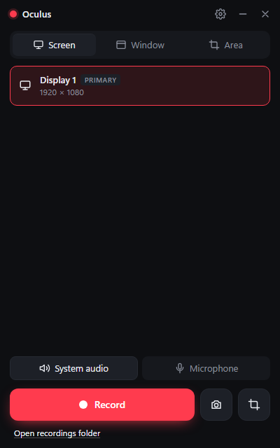

# Oculus

Lean Windows screen recorder + screenshot tool. Tauri 2 + React 19 UI; capture, encode and
audio are native Rust on OS APIs — no Electron, no FFmpeg.



See [OCULUS_PROJECT_GUIDE.md](OCULUS_PROJECT_GUIDE.md) for the detailed owner/developer handbook:
features, workflows, architecture, completed work, test evidence, remaining tasks and personal-use priorities.
Use [TODO.md](TODO.md) for the detailed work checklist. These three files are the project's documentation.

## Requirements and features

Windows 10 version 2004 (build 19041) or later, or Windows 11, with WebView2 and a graphics
driver that supports Windows Graphics Capture. Development additionally requires Node.js 24,
rustup and Visual Studio C++ build tools; rust-toolchain.toml pins Rust 1.99.1.

Record a display, window or selected area to H.264/HEVC MP4 with optional system sound and
microphone audio. Capture PNG screenshots, copy image pixels/files and use global shortcuts
or the tray to control recording. Settings include audio devices, gain, hotkeys and launch at login.

```
WGC frame (BGRA, GPU) ─▶ ID3D11VideoProcessor: crop + letterbox + BGRA→NV12 (BT.709), one pass
                      ─▶ tracked-sample NV12 pool ─▶ IMFSinkWriter (HW H.264/HEVC) ─┐
WASAPI loopback + mic ─▶ QPC-clocked mixer (zero-fill, drift realign) ─▶ AAC ───────┴▶ MP4
```

## Run

```bash
npm install
npm run tauri dev
```

## Build installer

```bash
npm run tauri build
```

## Hotkeys

`Ctrl+Shift+R` record/stop · `Ctrl+Shift+P` pause · `Ctrl+Shift+S` screenshot of current source ·
`Ctrl+Shift+A` area screenshot. Closing the window sends Oculus to the tray (the webview is
destroyed; ~6 MB private memory while idle).

These are the default shortcuts. Settings → Hotkeys lets you change them, disable individual
actions with an empty binding, or disable global hotkeys entirely. Conflicting bindings leave
the previous configuration active. Tray and panel controls remain available when hotkeys are off.
Optional bindings are available for microphone mute, record an area immediately, and record the
window under the cursor. These start unassigned.

Area selection freezes the displays. Drag an area or click a highlighted window, then move/resize
the selection before pressing Enter. Arrows move one pixel, Shift+arrows move ten, Alt+arrows resize,
Space toggles move mode, and Escape or right-click cancels. Holding Shift while drawing makes a square.

Recording settings offer 24/30/48/50/60/72/120 fps, output-height limits, an optional 2–150 Mbps
bitrate, and encoder-default/CBR/VBR rate control. Hardware may reject an explicit mode; choose
Encoder default in that case. A two-second keyframe interval is requested where supported.
Constant frame rate is enabled by default and required for H.264: sparse timestamps in the
Windows fragmented MP4 path can shorten video at fragment boundaries. Repeated frames use a
separate bounded GPU surface pool. This costs more encoder work on static screens. HEVC also
supports an optional variable-frame-rate mode in Settings.

The tray turns red while recording and amber with pause bars while paused; its tooltip shows
the recording time. The compact bar advances its timer between backend snapshots and freezes it on pause.

Saved recordings and screenshots appear in a card with a thumbnail, filename and size. Recordings also show
their duration. Open the file, show it in Explorer, copy it as a file for pasting into other apps, or rename it.
Delete asks for confirmation and permanently removes the file; it does not send it to the Recycle Bin.
If Windows cannot generate a thumbnail, file actions remain available with a media icon.

Successful screenshots also show a five-second floating preview, including when Oculus is in the tray.
Click the preview to open the image, or dismiss it with its close button. The preview is excluded from capture.
Drag a preview or card thumbnail into another app to copy the saved file; Escape cancels the drag.
Settings → Screenshots has an optional shutter sound, off by default.

The recording bar provides live system-audio and microphone mute controls. Muting affects saved
audio while device capture remains active. Settings → Audio chooses a specific endpoint or
Default to follow Windows' device changes. Settings → About provides copyable local diagnostics.

## Headless pipeline checks (debug builds only)

```bash
src-tauri/target/debug/oculus.exe --selftest out.mp4 --secs 8 --pause 2,3 --sys --mic
```

Flags: `--window TITLE`, `--region x,y,w,h`, `--fps N`, `--hevc`, `--resize-at T,W,H`,
`--height N`, `--bitrate Mbps`, `--cbr`, `--vbr`, `--vfr` (HEVC only), `--shot out.png`, `--mem`, `--list`, `--kill-at T`.
The last flag exits with code 86 after T wall seconds
without stopping/finalizing. See `src-tauri/src/selftest.rs`.

Run `npm run verify` for Rust and JavaScript tests, Clippy, frontend/debug builds, recording/pause/audio checks, hard-exit
recovery, startup cancellation, and slow-finalization quit checks. It needs an unlocked interactive Windows
desktop and developer-installed `ffmpeg`/`ffprobe` on PATH; neither is bundled with Oculus. Add
`-- -IncludeHevc` to also test HEVC on hardware that supports it. Recordings stay in a unique temporary folder.

The verifier also injects a two-second writer stall to check bounded buffering and partial-file retention.
Debug selftests accept `--stall-writer-ms N` and `--stall-mixer-ms N` for backpressure experiments; the latter
needs an active audio endpoint to fill the input queue. These switches are absent from release builds.

After building the debug recorder, `npm run verify:stress` records six short pause/resume clips
and a five-minute clip with system/mic audio. It checks decoding, seeking, a complete 60 fps
frame grid and audio/video endpoints, and samples private memory/handles every five seconds.
Artifacts and resource CSVs stay in a unique temporary folder. Override with
`npm run verify:stress -- -Repetitions 10 -Seconds 600`. The desktop must remain unlocked.
This checks endpoint durations; it does not replace an acoustic sync test or a one-hour soak.

## Recording safety

H.264 recordings use fragmented MP4. Completed fragments can play after a process crash or hard exit;
the current fragment and data buffered by Windows may be lost. A crash before the first complete fragment
can still leave no playable video. Writer errors retain partial output and report its path.

HEVC still uses regular MP4 because the fragmented Media Foundation sink rejects HEVC on the tested system.
HEVC files need successful finalization and remain vulnerable to hard termination. Editor compatibility
for fragmented H.264 is still being checked; ffprobe inspection, full decoding and seeking pass locally.

Quit waits for finalization. Suspend/logoff handlers request finalization too, but Windows can force a
shutdown before it completes. Saves use unique names; unavailable output folders fall back to
`Videos\Oculus` with a warning. Low disk space warns below 2 GB and stops recording below 200 MB.

Media queues are bounded. If capture or the encoder/output disk cannot keep up, Oculus stops with an error
and retains partial output. Stop requests use a separate nonblocking channel. Finalization flushes the
mixer tail and pads any remaining audio gap to the last written video frame.

Diagnostics stay in `%LOCALAPPDATA%\Oculus\logs`: five rotating 1 MiB logs and a bounded `panic.log`
with panic messages and backtraces. Oculus does not upload recordings or collect telemetry. The installer
can download Microsoft WebView2 when it is missing.

Saved-file links use Windows' native folder-selection API and accept only existing files within
the current output folder, after resolving junctions and symlinks. After changing the output folder,
open older recordings from their original folder in Explorer.

The Open, Copy file, Rename and Delete commands additionally accept only outputs remembered by the recorder. Renaming
preserves the file extension and refuses to overwrite another file.

The webview has explicit permissions for recorder subscriptions, titlebar controls and the folder picker.
Production loads scripts/styles from bundled assets and connects only to local Tauri IPC. Vite's injected
styles and hot-reload connection are allowed separately during development.

Oculus is licensed under the [MIT License](LICENSE).
See the [privacy and security section](OCULUS_PROJECT_GUIDE.md#142-privacy-and-security-model) for capture, clipboard and local-diagnostic data handling.

## Known limitations and FAQ

- Protected/DRM content can appear black. Exclusive-fullscreen games may prevent capture or
  region selection; use borderless/windowed mode where possible.
- Window capture follows a single native window. Separate popup menus and tooltips may be omitted.
  Minimized targets may stop delivering images; the last frame is repeated until capture resumes.
- HDR capture currently uses SDR surfaces and may produce washed-out colors. HDR tone mapping is pending.
- Older Windows builds may retain the system capture border even when border suppression is requested.
- **Does the video have constant frame rate?** Yes by default. H.264 requires it to keep the
  fragmented MP4 timeline correct. HEVC can use variable frame rate when the setting is disabled.
- **Why can an old saved-file action fail?** Actions validate against the current output folder.
  After changing folders, open older files from their original folder in Explorer.
- HEVC crash safety, cross-editor import, mixed-DPI and additional GPU/Windows combinations
  still need validation. See TODO.md for the release checklist.

Oculus targets Windows. Streaming, Linux/macOS support and a full nonlinear video editor are
outside the project's current scope. No FFmpeg or Electron is bundled.

## Layout

See [how the application works internally](OCULUS_PROJECT_GUIDE.md#6-how-the-application-works-internally) for the pipeline, threading, timing and lifetime rules.

| Path | Role |
| --- | --- |
| `src-tauri/src/capture/` | Shared D3D11 device, raw WGC session, video processor + NV12 pool |
| `src-tauri/src/encode/mf_writer.rs` | Two-stream `IMFSinkWriter` |
| `src-tauri/src/audio/` | WASAPI capture threads, timeline mixer (unit-tested) |
| `src-tauri/src/clock.rs` | Shared QPC timeline, first-frame latch, pause math |
| `src-tauri/src/session.rs` | One recording: wiring, writer loop, keep-alive, teardown |
| `src-tauri/src/recorder.rs` | App state machine, `recorder://state` snapshots |
| `src-tauri/src/overlay/region.rs` | Native freeze-frame region picker (Win32 + D2D) |
| `src/hooks/useRecorder.js` | Subscribe-then-hydrate, `seq`-ordered snapshots |
