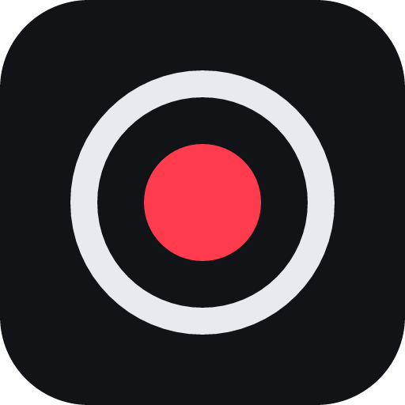
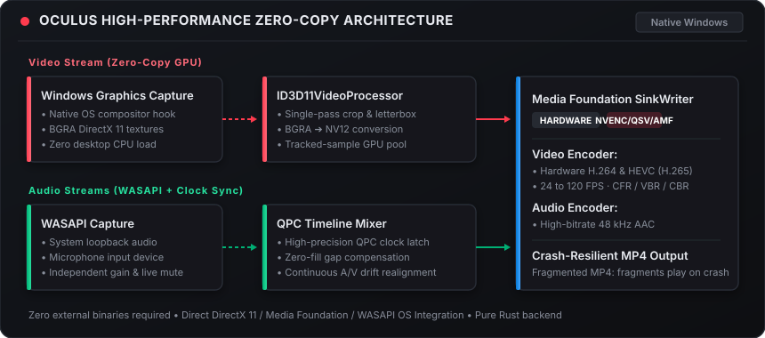
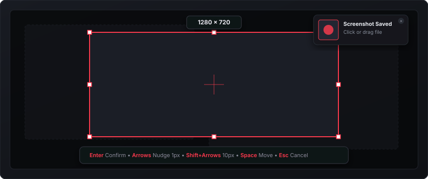

<div align="center">



# Oculus

**A lean, high-performance Windows screen recorder and screenshot tool crafted with Tauri 2, Rust &amp; React 19**

*Native Windows Graphics Capture, Direct3D 11 &amp; Media Foundation hardware encoding — no Electron, no FFmpeg.*

<p>
  <a href="LICENSE"></a>
  
  
  
  
  
</p>

---

<p>
  <a href="#-about-oculus">About</a> •
  <a href="#-key-features">Features</a> •
  <a href="#-architecture--pipeline">Architecture</a> •
  <a href="#-visual-tour">Visual Tour</a> •
  <a href="#-keyboard-shortcuts">Shortcuts</a> •
  <a href="#-getting-started">Getting Started</a> •
  <a href="#-building-from-source">Building</a> •
  <a href="#-recording-safety">Safety</a> •
  <a href="#-icon--design-philosophy">Design</a> •
  <a href="#-license--documentation">License</a>
</p>

<picture>
  
</picture>

</div>

---

## 👁️ About Oculus

**Oculus** is a lightweight, local-first Windows application engineered for creators, developers, and power users who need instant screen recording and pixel-perfect screenshots without the overhead of massive multi-hundred-megabyte runtimes.

Instead of bundling heavy third-party binaries like Electron or FFmpeg, Oculus communicates directly with native Windows operating system subsystems:
- **Direct3D 11 &amp; Windows Graphics Capture (WGC)**: Hardware-composited surface capture with zero CPU overhead.
- **DirectX Video Processor**: Single-pass GPU crop, letterbox, and BGRA-to-NV12 color conversion.
- **Microsoft Media Foundation**: Direct hardware acceleration via NVENC, Intel QuickSync, or AMD AMF.
- **Windows Audio Session API (WASAPI)**: Low-latency system loopback and microphone capture synchronized against a microsecond-accurate QueryPerformanceCounter (QPC) master clock.

### 🌟 Core Principles

- 🪟 **Pure Native Integration**: Runs natively on Windows 10 (version 2004 build 19041+) and Windows 11 with seamless tray integration and global shortcuts.
- 🪶 **Ultra-Lean Footprint**: Built with Tauri 2 and Rust. When minimized to the system tray, the WebView unloads, settling into an idle footprint of **~6 MB** private working set memory.
- 🛡️ **100% Local-First &amp; Private**: Zero telemetry, zero analytics pings, no mandatory accounts, and no background cloud uploads. Your recordings and screenshots never leave your PC.
- ⚡ **Crash-Resilient Pipeline**: H.264 recordings utilize fragmented MP4 (`fMP4`) containers. Completed fragments remain playable and valid even if Windows experiences an abrupt shutdown, power loss, or crash.

---

## ✨ Key Features

<table>
  <tr>
    <td width="50%">
      <h3>🖥️ Flexible Capture Targets</h3>
      <p>Record entire multi-monitor desktops, select individual application windows, or draw an arbitrary pixel-exact bounding box with the interactive freeze-frame selector.</p>
    </td>
    <td width="50%">
      <h3>⚙️ Hardware-Accelerated Video</h3>
      <p>Encode directly to MP4 using hardware H.264 or HEVC (H.265). Select frame rates from 24 up to 120 FPS, set custom bitrates (2–150 Mbps), and choose CBR or VBR rate control.</p>
    </td>
  </tr>
  <tr>
    <td width="50%">
      <h3>🎙️ Dual-Channel Audio &amp; Live Mute</h3>
      <p>Mix system audio loopback with microphone input in real-time into high-bitrate AAC. Adjust device gain independently and toggle live audio mute during active recordings.</p>
    </td>
    <td width="50%">
      <h3>📸 Precision Screenshots &amp; Floating HUD</h3>
      <p>Capture instant PNG screenshots with global hotkeys. Includes a 5-second non-intrusive floating preview card with one-click drag-and-drop into chat, email, or image editors.</p>
    </td>
  </tr>
  <tr>
    <td width="50%">
      <h3>🎯 Direct2D Freeze-Frame Region Picker</h3>
      <p>Nudge selections by 1px with arrow keys or 10px with Shift+arrows. Click any hovered window to snap automatically, hold Shift for 1:1 squares, or press Space to move.</p>
    </td>
    <td width="50%">
      <h3>📁 Recent Recordings &amp; File Management</h3>
      <p>Instant file cards with thumbnail generation, duration, and file size. Open, reveal in Explorer, copy raw file data to clipboard, rename in-place, or permanently remove files.</p>
    </td>
  </tr>
</table>

---

## 🏗️ Architecture &amp; Pipeline

Oculus bypasses user-space frame copying by keeping capture, color-space conversion, and hardware encoding entirely within GPU memory:

<p align="center">
  
</p>

### Pipeline Breakdown

1. **GPU Video Capture**: Windows Graphics Capture delivers raw BGRA surfaces directly from the D3D11 compositor.
2. **DirectX Video Processing**: `ID3D11VideoProcessor` crops, letterboxes, and transforms surfaces to NV12 (BT.709 color matrix) in a single hardware pass.
3. **Audio Timeline Alignment**: WASAPI threads feed a continuous timeline mixer clocked against the Windows `QueryPerformanceCounter` (QPC). Silent gaps are zero-filled and drift is continuously realigned against the video stream.
4. **Hardware Sink Writer**: Audio and video packets stream through Media Foundation `IMFSinkWriter`, producing compliant MP4 or fragmented MP4 (`fMP4`) containers.

---

## 📸 Visual Tour

### 1. Unified Control Panel &amp; Recent Recordings
Configure capture targets, audio inputs, video frame rates, and encoding quality. Access the last 10 session recordings with live thumbnail previews, file sizes, and instant management actions.

<p align="center">
  
</p>

### 2. Interactive Freeze-Frame Area Selector
Freeze all active monitors to accurately draw, resize, or snap capture regions. Fine-tune boundaries using keyboard nudges and view exact pixel dimensions in the real-time HUD.

<p align="center">
  
</p>

### 3. Floating Preview &amp; Direct File Dragging
Completed screenshots display a transient preview window that is automatically excluded from subsequent captures. Drag the thumbnail straight from the card into Discord, Slack, GitHub, or Explorer.

---

## ⌨️ Keyboard Shortcuts

Global hotkeys allow you to initiate and control recordings even when Oculus is minimized to the system tray:

| Shortcut | Action | Description |
| :--- | :--- | :--- |
| `Ctrl + Shift + R` | **Start / Stop Recording** | Toggle recording on the currently selected source |
| `Ctrl + Shift + P` | **Pause / Resume** | Freeze capture timeline; tray icon turns amber |
| `Ctrl + Shift + S` | **Quick Screenshot** | Capture active source directly to a PNG file |
| `Ctrl + Shift + A` | **Area Screenshot** | Freeze displays and launch the interactive region picker |

### Region Selector Controls

| Input | Effect |
| :--- | :--- |
| **Drag** | Draw bounding rectangle |
| **Click Window** | Snap selection box to window boundaries |
| **Arrow Keys** | Nudge selection by **1 pixel** |
| **Shift + Arrow Keys** | Nudge selection by **10 pixels** |
| **Alt + Arrow Keys** | Resize selection box by 1 pixel |
| **Shift (while dragging)** | Constrain aspect ratio to a 1:1 square |
| **Space** | Toggle move mode |
| **Enter** | Confirm selection and trigger capture |
| **Escape / Right Click** | Cancel selection |

> [!TIP]
> All hotkeys can be customized or disabled under **Settings → Hotkeys**. Tray and panel controls remain fully functional when global shortcuts are deactivated.

---

## 🚀 Getting Started

### System Requirements

- **Operating System**: Windows 10 (version 2004 / build 19041 or higher) or Windows 11
- **Graphics Driver**: GPU driver supporting Windows Graphics Capture (Direct3D 11 Feature Level 11_0+)
- **Runtime**: Microsoft Edge WebView2 (installed by default on modern Windows; bootstrapped by installer if absent)

### Quick Run

Download the latest installer or build from source:

```powershell
# Run the application in developer mode
npm install
npm run tauri dev
```

---

## 🛠️ Building from Source

### Prerequisites

Ensure you have the following installed on your Windows development environment:
- **Node.js** (v24+ recommended)
- **Rust Toolchain** (Rust 2021 edition; pinned to `1.99.1` via `rust-toolchain.toml`)
- **Visual Studio C++ Build Tools** (with "Desktop development with C++" workload)

### Build Commands

```powershell
# 1. Install frontend dependencies
npm ci

# 2. Run the Tauri development environment
npm run tauri dev

# 3. Build production binaries and NSIS installer
npm run tauri build
```

Production installers and binaries are output to:
```
src-tauri/target/release/bundle/nsis/
```

### Running Tests &amp; Verification

Oculus includes a comprehensive verification harness testing audio mixing, timeline latching, writer backpressure, and hard termination:

```powershell
# Run Rust unit tests
cargo test --manifest-path src-tauri/Cargo.toml

# Run JavaScript frontend regression tests
npm test

# Run full pipeline verification (requires interactive desktop)
npm run verify
```

---

## 🛡️ Recording Safety

- **Fragmented MP4**: H.264 video streams use fragmented MP4 (`fMP4`). If your computer loses power or the process terminates abruptly, completed chunks remain intact and playable.
- **Bounded Buffer Queues**: High-load scenarios throttle gracefully. If the storage drive cannot keep up with encoder throughput, Oculus halts safely rather than exhausting system memory, preserving the recorded file.
- **Disk Space Sentinel**: Warns when free disk space falls below **2 GB** and automatically finalizes and stops recording if storage reaches **200 MB**.
- **Symlink &amp; Traversal Guard**: Path verification resolves Windows directory junctions to ensure file actions operate strictly within the user's designated output directory.

---

## 🎨 Icon &amp; Design Philosophy

<p align="center">
  
</p>

> *"A precision optical lens aperture encased in an obsidian housing, illuminated by an active scarlet recording iris."*

The Oculus visual identity reflects precision engineering and restraint:
- **Obsidian Enclosure (`#111317`)**: Represents stability, low resource consumption, and dark-mode ergonomics.
- **Aperture Ring (`#e8eaf0`)**: Symbolizes clear optical capture and pixel-perfect rendering.
- **Scarlet Recording Iris (`#ff3b4e`)**: The universal tally light indicating active, trusted recording.

---

## 📜 License &amp; Documentation

Oculus is open-source software licensed under the **[MIT License](LICENSE)**.

- **Developer Handbook**: Read [OCULUS_PROJECT_GUIDE.md](OCULUS_PROJECT_GUIDE.md) for in-depth architecture details, lifetime rules, and validation reports.
- **Task Checklist**: See [TODO.md](TODO.md) for ongoing work items and upcoming roadmap milestones.
- **Diagnostics**: Local rotating logs and panic backtraces are saved locally at `%LOCALAPPDATA%\Oculus\logs`. Oculus contains **no external telemetry**.